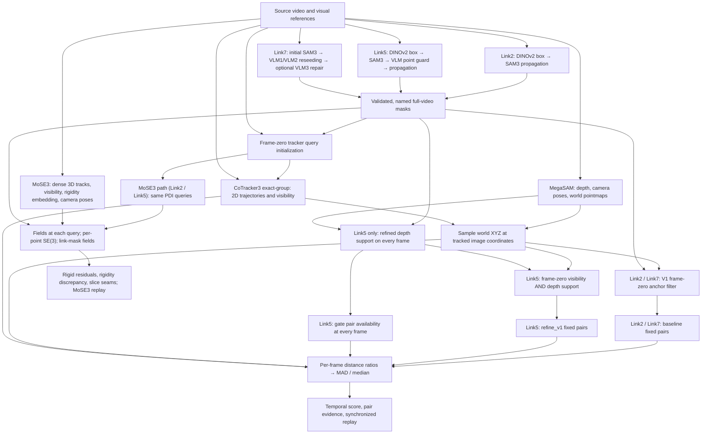
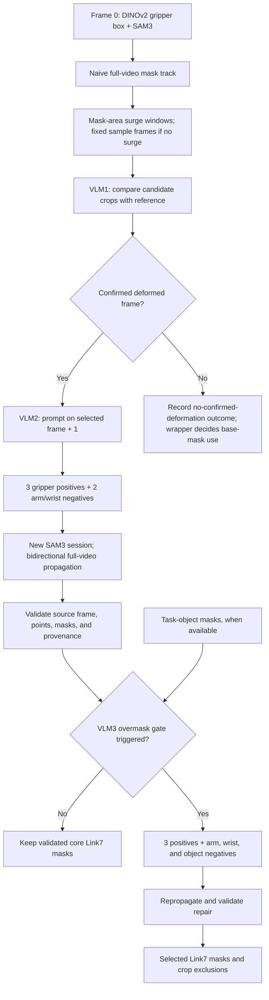
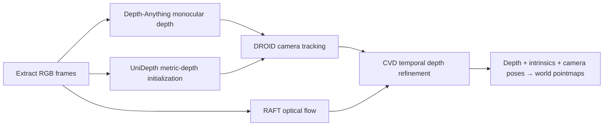
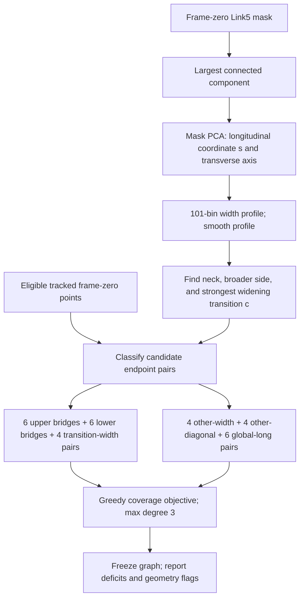

# Robot deformation pipeline: Link2, Link5, and Link7

This document describes the repository implementation as inspected on October 11,
2026: how a video becomes link masks, tracked 3D points, a fixed pair graph, and a
rigidity score. The scope is `exact-group` CoTracker3 tracking, baseline pair
selection for Link2/Link7, and `refine_v1` pair selection with all-frame refined
depth support for Link5. The Link5 implementation lives in
[`robot/experiments/link5_pair_selection_ablation`](experiments/link5_pair_selection_ablation/README.md).

**The central idea:** SAM3 identifies the pixels belonging to each link;
MegaSAM reconstructs scene geometry; CoTracker3 follows image points; the scorer
samples the geometry at those tracked locations and measures changes in distances
between selected pairs. The VLM helps establish masks, not 3D coordinates or the
final pair graph.

**Two rigidity paths.** For Link2 and Link5, the PDI pair path above has a parallel
path of equal standing, the **MoSE3 tracking path** (section 9). It starts from the same
frame-zero masks and the same PDI query sampler. MoSE3 then provides 3D tracks,
visibility, rigidity embeddings and SE(3) from RGB alone, and the path scores rigid
residuals, rigidity discrepancy and slice seams instead of pair distance ratios.

## 1. End-to-end architecture



This is a data-dependency diagram. In the shared implementation,
[`MultiObjectPDIEvaluationPipeline.run`](workflows/pipeline.py) obtains
MegaSAM geometry before preparing and running CoTracker. Query initialization
necessarily precedes tracking; pair selection occurs after frame-zero visibility
and sampled geometry are available. Link5's refined depth support consumes native
MegaSAM depth and masks on every frame; it gates frame-zero anchor selection and
later pair availability. This all-frame support filter applies to **Link5 only**
in the architecture described here.

Three different kinds of “points” must be kept separate:

| Kind | Purpose | Created by |
| --- | --- | --- |
| SAM prompt points | Include or exclude material from a mask | Link5 VLM guard or Link7 VLM2/VLM3 |
| CoTracker queries | Initialize image trajectories, normally at frame zero | SIFT, Shi–Tomasi, and grid sampling |
| Pair endpoints | Choose which tracked distances enter the rigidity score | A frame-zero pair selector |

SAM3's video propagation tracks **masks**. CoTracker tracks **points**. MegaSAM is
the geometry system; it does not replace either of those operations.

## 2. Link-specific segmentation

| Link | Initial localization | Special processing | Scoring path described here |
| --- | --- | --- | --- |
| Link2 | DINOv2 reference matching → box | SAM3 box/text prompt and video propagation; no dedicated VLM point guard in this path | CoTracker3 + V1 anchor filter + shared baseline pairs |
| Link5 | DINOv2 reference matching → right-extended box | VLM reviews forearm positives and wrist negatives, then SAM3 propagates the refined mask | CoTracker3 + all-frame refined depth support + `refine_v1` pairs |
| Link7 | DINOv2 gripper reference box → initial SAM3 mask | VLM1 finds a reseeding opportunity; VLM2 supplies gripper points; VLM3 can repair object overmasking | CoTracker3 + V1 anchor filter + shared baseline pairs |

### Link2: reference-guided SAM3

[`single_link_masks`](workflows/coordination.py) invokes
[`sam3_dinov2_segment.py`](preprocessing/segmentation/sam3_dinov2_segment.py) for
`link2`. DINOv2 compares the prompt frame with reference images, producing a
localization box. SAM3 receives the box and text prompt, selects an initial
candidate, and propagates it through the video. The segmenter maintains the object
identity, with association logic when SAM changes IDs.

The result is a named mask channel in `segmentation.npz`, accompanied by box,
prompt, propagation, and source-identity records. The coordinator requests a
minimum tracked fraction of 0.80. Link2 does **not** pass through Link5's guard or
Link7's VLM1/VLM2 repair chain.

### Link5: preserve the forearm and exclude the neighboring wrist

The same segmenter extends the DINOv2 box to the right by 20% of its width,
clamped to the image. Link5 has a dedicated text prompt describing the elongated
white forearm surrounding and to the right of the black inset.

After the initial SAM3 result,
[`link5_point_guard.py`](preprocessing/link5_refinement/link5_point_guard.py)
performs independent reference-assisted reviews:

1. **Positive placement:** return all three forearm points, P1/P2/P3. P1 has no
   box-relative fallback; the VLM must explicitly place it. P2/P3 are reviewed
   against the reference and retained or moved onto the intended forearm material.
2. **Negative review:** review N1/N2 on the neighboring wrist material. In the
   current guard, only N1 must lie inside the SAM box or its five-pixel margin;
   N2 may lie outside. Negative parsing failures or an invalid N1 retry identical
   inputs, with three total attempts. Exhaustion stops that case.
3. **SAM refinement:** prime the SAM tracker cache, apply the points to the
   selected object, then propagate bidirectionally across the full video.

The coordinator enables the guard and requests **three positives plus two
negatives**. The segmenter's standalone default also supports a third negative
on the right joint, so prompt count must be read from the actual run configuration.
Point membership and forearm retention are saved as diagnostics; the current
refinement function retains the VLM-selected prompt and SAM output even when
those diagnostics disagree. Passing the guard is therefore not proof that the
resulting mask is anatomically correct.

The retained pair-selection experiment starts from the **already selected mask
cache**. It does not call the VLM or SAM again.

### Link7: persistent gripper masking and repair



The maintained implementation is
[`link7_persistent/pipeline.py`](preprocessing/link7_persistent/pipeline.py):

- **Initial track:** [`naive_sam3.py`](preprocessing/link7_persistent/naive_sam3.py)
  prompts once at frame zero, selects the highest-scoring SAM candidate, and
  follows that object ID. Here, “naive” means mask initialization without later
  corrections; it is unrelated to naive pair selection.
- **VLM1 candidate frames:** find upward log mask-area ratios of at least 0.25,
  with events separated by approximately half a second. Review frames from four
  before through five after each event. With no event, sample approximately
  30%, 48%, 52%, 60%, and 70% of the sequence. VLM1 compares candidate crops with
  a nondeformed reference and records normal/deformed/unclear outcomes.
- **VLM2 reseeding:** start with the earliest valid VLM1 deformation diagnosis
  and prompt on the **following original frame**. Positive roles are two separate
  dark gripper regions and the white palm; negatives are the forearm and wrist.
  The current `run_case` keeps that reseed frame fixed: malformed responses or
  null positive points use a configured alternate VLM route on the same images,
  within a shared per-case fallback budget (default one alternate attempt).
  Failure to obtain valid points stops this stage. Older interface prose about
  advancing to another confirmed frame does not describe this current caller.
  See the exact
  [point prompts](preprocessing/link7_persistent/vlm_prompts.py).
- **Propagation:** a fresh SAM3 session uses these five points and propagates in
  both directions, including back to frame zero. Source-frame lineage and mask
  dimensions are checked before the result is accepted.
- **Optional VLM3:** when task-object masks are available,
  [`vlm3_overmask.py`](preprocessing/link7_persistent/vlm3_overmask.py) checks for
  more than 95% of the task object's area being covered by Link7, or the existing
  oversized-mask gate. It adds an object negative to the arm/wrist negatives,
  uses three gripper positives, and repropagates. Accepted repairs can retain
  residual bad frames as explicit **crop exclusions**. These exclusions are not
  automatically the rigidity scorer's per-frame availability gate. The coordinator
  blocks downstream work if required repair fails.

This masking process can inspect later frames and propagate backwards. Thus
“frame-zero pair selection” means the graph is chosen from frame-zero inputs;
it does not make the overall segmentation/tracking system causal or online.

## 3. MegaSAM: reconstruct geometry once per video

[`MegaSamWrapper`](../infrastructure/shared/inference/mega_sam_wrapper.py) runs:



For pixel `(u,v)` with camera depth `z`, backprojection gives
`X_camera = ((u-cx)z/fx, (v-cy)z/fy, z)`, followed by
`X_world = R_camera_to_world X_camera + t_camera_to_world`.

The shared pipeline caches one scene reconstruction and derives per-link depth
measurements from the corresponding masks. Link2, Link5, and Link7 do not need
independent scene reconstructions. Masks identify target regions; they do not
turn MegaSAM into a separate object-specific reconstruction model.

The generic wrapper permits raw DROID output when CVD is unavailable, while its
shared entry point rejects all-zero fallback geometry. The Link5 ablation's
[`prepare_gpu.py`](experiments/link5_pair_selection_ablation/prepare_gpu.py) is
stricter: it requires receipted native **full-sequence CVD** geometry and rejects
raw-DROID/fallback preparation. Its native depth and intrinsics are retained for
the subsequent depth-support filter.

## 4. Tracker-point initialization and CoTracker3

### Common sampler and Link2/Link7 tracking

[`TrackWrapper.prepare_multi`](../infrastructure/shared/inference/tracking.py)
decodes the video, limits the largest tracker-image dimension to 880 by default,
and resizes frame-zero masks with nearest-neighbor interpolation. Each link's
queries are initialized within its frame-zero mask using
[`CoTrackerCore._sample_region_queries`](../infrastructure/shared/inference/cotracker_core.py):

1. Gather SIFT keypoints, Shi–Tomasi corners, and deterministic grid points.
2. Deduplicate candidates by image coordinate.
3. Use greedy farthest-point selection to distribute queries over the region.
4. Store explicit `(time=0, x, y)` queries; fewer than two unique points is an error.

This multi-object sampler pools all three candidate sources. The older
single-object `infer` method has different fallback behavior and should not be
used to describe the current multi-object initialization.

With [`configs/default.yaml`](configs/default.yaml), Link2 requests 256 queries;
Link5 and Link7 each request 100 (`grid_size=10`, squared). These are requested
counts, not guaranteed surviving anchors. The shared background requests 225
points outside the union of masks, with a five-pixel dilation on the tracker grid.

CoTracker3 uses **`exact-group`**: each link and the background are tracked as
separate query groups, reusing cached video-backbone features in the shared
wrapper. Results include 2D trajectories and visibility.
The standard wrapper maps them back to source pixels and drops whole tracks with
nonfinite values, mean visibility below 0.3, or a maximum inter-frame jump of
120 source pixels or more. This quality check uses the full trajectory. Point IDs
are retained for the surviving tracks.

### Link5 refine_v1 path: frozen explicit queries and raw tracks

The experiment reuses queries originally saved by
[`pair_initialization.py`](experiments/link5_shape_codebook/pair_initialization.py):

- Use only frame-zero RGB and the selected frame-zero Link5 mask.
- Keep the largest mask component and erode it by two source pixels with a
  5×5 square kernel for query support.
- Apply the same SIFT/corner/grid sampler at maximum image dimension 880,
  requesting 100 queries.
- Map queries back to source pixels, reject resize-boundary violations, and save
  `query_points_xy` plus stable `point_ids` in `pairs.json`.

GPU preparation verifies the video, mask, and query-initialization hashes. It
scales those source-pixel queries directly to the native CVD pointmap grid,
resizes RGB to that grid, and calls `_run_queries` with explicit time-zero queries.
It saves **unfiltered** tracks and raw visibility, bypassing the shared wrapper's
whole-trajectory quality rejection. This Link5-only preparation runs its explicit
queries as a single link group. The `refine_v1` scorer consumes these arrays after
depth support is computed. The graph saved in the original CPU initialization
preview is not automatically the graph used for scoring.

## 5. Lift tracks to 3D and determine anchor eligibility

At every frame, map each tracked image coordinate onto the pointmap grid, round
to the nearest pixel, and sample its world XYZ. The shared scorer clips sampled
indices to the grid bounds. The Link5 depth-support layer additionally rejects
out-of-bounds queries when determining support.

### Link2 and Link7: V1 anchor filter

For Link2 and Link7,
[`audit_3d_rigidity_cv`](../infrastructure/shared/scoring/rigidity/rigidity.py)
uses frame-zero visibility `> 0.5`, preferring points below the 75th percentile
of the visible points' Sobel **world-Z** gradient. If that leaves fewer than five
anchors, it falls back to visible points alone. This is a world-coordinate
gradient heuristic, not a camera-depth density filter.

### Link5 only: refined depth support on every frame

[`filter_video_depth.py`](experiments/link5_pair_selection_ablation/filter_video_depth.py)
applies the shared
[`link5_depth_filter.py`](preprocessing/depth/link5_depth_filter.py) to every
original Link5 frame before `refine_v1` scoring:

1. Erode the intact source mask by two source pixels using an elliptical kernel,
   then align it to the native depth grid. This support filter is distinct from
   the square-kernel erosion used during query initialization.
2. Reject nonfinite or nonpositive camera depth.
3. Lift candidate pixels to camera XYZ and compute their mean distance to the
   nearest 32 neighbors, excluding themselves.
4. Divide that distance by the pixel footprint `z / sqrt(fx*fy)`.
5. Reject density scores above `max(3 × median, median + 6 × scaled_MAD)`, where
   `scaled_MAD = 1.4826 × median(abs(score - median))`.
6. Require at least 256 retained pixels and a retained fraction of at least 0.5
   relative to the aligned input mask. A failed frame disables query support.

The filter selects observed pixels; it does not smooth depth or move XYZ.
Frame-zero anchors require **raw visibility > 0.5 AND depth support**, without
gradient or visible-only fallback. Later support gates the availability of the
already selected endpoints. It does not trigger graph reselection.

## 6. Pair selection by link

| Property | Link2 / Link7 baseline | Link5 `refine_v1` |
| --- | --- | --- |
| Spatial prior | Long 3D baselines, interior endpoints | Mask-width transition plus global coverage |
| Target pairs | Top 30 | 16 transition-focused + 14 remaining |
| Maximum point degree | No explicit cap | 3 |
| Selection geometry | Frame-zero world XYZ and mask edge distance | PCA and width profile of the frame-zero mask |
| Anchor eligibility | V1 visibility and world-Z gradient heuristic | Frame-zero raw visibility AND refined depth support |
| Later pair availability | Both endpoints visible | Both endpoints visible AND depth-supported |

### Link2 and Link7: baseline pair ranking

For every eligible unordered pair `(i,j)`, calculate:

```text
baseline_ij = ||X_i(0) - X_j(0)||
interior_ij = min(mask_edge_distance_i, mask_edge_distance_j)
rank_ij     = baseline_ij × interior_ij
```

Take the 30 highest ranks, then discard baselines `<= 1e-3` in reconstruction
units. There is no orientation quota, transition-region preference, or endpoint
degree cap. Consequently, the ranking can concentrate on a few interior endpoints
and long measurements. Dropped pairs are not automatically replaced.

### Link5: transition-focused selector `refine_v1`

[`refine_v1.py`](experiments/link5_pair_selection_ablation/refine_v1.py) uses the
mask silhouette to place more measurements around a narrow-to-broad transition.
This is a geometric prior, not a guaranteed anatomical joint detector.



The implementation computes lower/upper transverse silhouette quantiles in 101
longitudinal bins, smooths their width, finds a neck in `s ∈ [0.25, 0.70]`, and
chooses the broader side by sustained excess width. It searches on that side for
a strong widening transition `c`. The transition band is `c ± 0.14`.

| Pair category | Quota | Main geometric condition |
| --- | --- | --- |
| `transition_upper` | 6 | Same upper flank, straddles `c ± 0.015`, both endpoints in the band, longitudinal separation 0.06–0.28 |
| `transition_lower` | 6 | Same lower flank, with the same bridge conditions |
| `transition_width` | 4 | Opposite flanks, midpoint in the band, longitudinal separation ≤ 0.075 |
| `global_long` | 6 | Longitudinal separation ≥ 0.50 |
| `other_width` | 4 | Opposite flanks, midpoint outside the band, longitudinal separation ≤ 0.09 |
| `other_diagonal` | 4 | Midpoint outside the band, longitudinal separation 0.07–0.27, sufficient transverse separation |

All candidates must meet `distance_2d >= max(8 pixels, 0.18 × local_width)`.
The greedy objective rewards midpoint novelty, penalizes endpoint reuse, and
prefers category-specific spans. Selection fills upper, lower, transition-width,
other-width, other-diagonal, then global-long quotas. Objectives are rounded to
12 decimal places before deterministic endpoint-index tie-breaking. No endpoint
may belong to more than three selected pairs.

Ambiguous broad side, weak transition, image-edge clipping, substantial secondary
components, and quota deficits remain in the evidence. Thirty pairs is a target,
not a forced outcome. The scorer applies the common `> 1e-3` 3D baseline check
after selection. The eight-pixel floor refers to the actual selector grid. A source-resolution preview
can therefore differ from the scored graph after native-grid resizing and anchor
eligibility filtering.

## 7. Fixed-pair scoring and interpretation

Both link-specific paths use the same rigidity formula. For available
selected pairs at frame `t`:

```text
d_ij(t) = ||X_i(t) - X_j(t)||
r_ij(t) = d_ij(t) / d_ij(0)
m(t)    = median over available pairs of r_ij(t)
e(t)    = median over available pairs of |r_ij(t) - m(t)| / (m(t) + 1e-6)
video rigidity score = mean of e(t) over frames 1 ... T-1
```

Frame zero has score zero and is excluded from the temporal mean. Link2 and Link7
require visibility `> 0.5` at both endpoints. Link5 additionally requires
current-frame refined depth support at both endpoints. With fewer
than three available pairs, the scorer carries the previous frame's score.
Fewer than five initial anchors or three nondegenerate initial pairs causes an
explicit failure in the maintained scoring callers (`insufficient_policy="raise"`).

Higher values mean greater inconsistency among pairwise distance ratios. This
is not a direct measure of absolute shape error: uniform scale changes can give
nearly equal ratios and low MAD; minority local changes can be suppressed;
occlusion can carry stale scores; temporal averaging can dilute short events.
Tracking and reconstruction errors can also raise the score.

The shared robot evaluator additionally computes scale and trajectory terms and
combines them into PDI through [`scoring/metrics.py`](scoring/metrics.py). The
Link5 pair ablation isolates **rigidity**; it does not train a shape codebook or
change the aggregation formula.

## 8. Data contracts, provenance, and implementation map

| Artifact | Contract / purpose |
| --- | --- |
| `segmentation.npz` | Named `object_masks[T,L,H_source,W_source]`, plus object identities and associated metadata |
| Shared geometry | World `pointmaps[T,H_geo,W_geo,3]`, camera-to-world poses, focal information, cache identity |
| Link5 saved `pairs.json` initialization | Source-pixel queries, stable point IDs, source/mask hashes; preview pairs are not final scored pairs |
| Link5 `shared_inputs/<case>.npz` | `pointmaps`, `tracks_2d[T,N,2]`, raw `visibility[T,N]`, aligned `masks[T,H_geo,W_geo]`, and point IDs |
| Link5 depth support | `valid_pixels`, rejection reasons, `query_support[T,N]`, frame-quality flags, matching point IDs |
| Per-method evidence | Selected pair indices/IDs, baseline distances, graph coverage, ratios, availability, carried frames, and scores |
| Replay | Synchronized video, point cloud, pair inspection, and score history; display sampling does not alter scoring arrays |

Preserve the distinction between source-image pixels, tracker pixels, and native
geometry pixels. The shared path maps tracker results back to source coordinates
and then to geometry coordinates; the ablation runs CoTracker directly on the
native geometry grid. Preserve original zero-based frame indices; replay display
frames may be one-based. Raw tracker visibility, finite XYZ, and depth-supported
availability are three separate quantities.

The main entry points and ownership boundaries are:

| Responsibility | Code |
| --- | --- |
| Resumable stage coordination and per-link mask assembly | [`workflows/coordination.py`](workflows/coordination.py) |
| Shared geometry/tracking/scoring orchestration | [`workflows/pipeline.py`](workflows/pipeline.py), [`workflows/score_v1.py`](workflows/score_v1.py) |
| Link2 and guarded Link5 segmentation | [`sam3_dinov2_segment.py`](preprocessing/segmentation/sam3_dinov2_segment.py), [`link5_point_guard.py`](preprocessing/link5_refinement/link5_point_guard.py) |
| Persistent Link7 repair | [`link7_persistent/pipeline.py`](preprocessing/link7_persistent/pipeline.py), [`vlm3_overmask.py`](preprocessing/link7_persistent/vlm3_overmask.py) |
| Geometry and tracking adapters | [`mega_sam_wrapper.py`](../infrastructure/shared/inference/mega_sam_wrapper.py), [`tracking.py`](../infrastructure/shared/inference/tracking.py) |
| Link2/Link7 baseline pair selection and rigidity | [`rigidity.py`](../infrastructure/shared/scoring/rigidity/rigidity.py) |
| Link5 refined pair selection | [`refine_v1.py`](experiments/link5_pair_selection_ablation/refine_v1.py) |
| Link5 completed all-frame depth-supported scoring | [`score_depth_v2.py`](experiments/link5_pair_selection_ablation/score_depth_v2.py), [`run_scores_depth_v2.py`](experiments/link5_pair_selection_ablation/run_scores_depth_v2.py) |

**Version names refer to different components.** `score_v1.py` is the shared
workflow; `point_filter_version="v1"` is its anchor heuristic; `refine_v1` is a
Link5 pair selector; `score_depth_v2.py` is the experiment's all-frame depth-support
scorer. Choosing one does not implicitly enable the others.

Link5's `refine_v1` implementation and all-frame support are documented in the
retained [experiment report](experiments/link5_pair_selection_ablation/results/20261007/REPORT.md).
The original planning sections of
[HANDOFF.md](experiments/link5_pair_selection_ablation/HANDOFF.md) are historical;
use its current-outcome section and the experiment README for the completed path.
The code entry points remain separate: Link2/Link7 use the shared scorer, while
the Link5 path described here uses `score_depth_v2.py` with
`pair_method="refine_v1"`. The generic shared scorer does not automatically enable
this Link5 policy.

## 9. MoSE3 tracking path (Link2 and Link5)

[MoSE3](https://mose3-tracker.github.io/) predicts, for every pixel of the query frame, a
world-space 3D track, a visibility logit and a 16-D rigidity embedding, from monocular RGB
alone. No MegaSAM geometry or CoTracker tracks are used. The path:

1. **Queries:** PDI's own sampler (`TrackWrapper.prepare_multi`, SIFT + Shi–Tomasi + grid) on
   the frame-zero Link2/Link5 masks; 256 Link2 and 100 Link5 points (`configs/default.yaml`).
2. **Tracking:** one MoSE3 pass over every frame (pinned `infrastructure/vendor/MoSE3`, CC BY-NC
   weights). Fields are read bilinearly at each query, avoiding depth edges. Each query gets
   upstream's per-pixel SE(3) (embedding-weighted Horn fit). MoSE3's fields over the link's
   frame-zero mask plus a 4 px band are cached for CPU-only fits.
3. **Signals:** with `L` the link length,
   - *rigid residual*: `||R(t) x_i(0) + t(t) − x_i(t)|| / L`, 90th percentile per frame. R, t come
     from MoSE3's per-point SE(3), from one Kabsch refit of the visible points, or from one
     robust (Cauchy IRLS) fit of every visible mask pixel (*dense mask fit*);
   - *rigidity discrepancy*: `1 − cos` to the link's mean embedding, 90th percentile;
   - *slice seams*: stretch, shear, bend and twist between Kabsch fits of four slices.
   A video's value is the maximum over frames 1…T−1.
4. **Evaluation and replay:** AUROC against the selected-45 labels (severe vs none, plus the
   C-index with moderate kept), and a MoSE3-style 3D tracking, SE(3) and error-signal replay.

| Responsibility | Code |
| --- | --- |
| Frozen inputs, PDI queries, single-H200 scheduling, MoSE3 worker, field sampling | [`workflows/mose3/`](workflows/mose3/README.md) |
| Signals and rigidity diagnostics | [`scoring/mose3/`](scoring/mose3/signals.py) |
| Label AUROC | [`analysis/mose3_label_auroc.py`](analysis/mose3_label_auroc.py) |
| Replay builder, 2D views, page templates | [`replay/mose3/`](replay/mose3/build_replay.py) |
| Runs | `robot/results/mose3/<run>` |

Interfaces: `links.mose3-queries`, `-track`, `-collect`, `-signals`, `-auroc`, `-views`,
`-replay` (`python -m deformation_detect list`). The resumable coordinator does not yet
schedule this path; it runs through `workflows/mose3/eris_pipeline.sh` (track, then signals)
on one shared H200. None of its signals is a validated deformation detector.

For future GPU execution, follow [`agent.md`](../agent.md): share one H200 across
independent videos, configure worker concurrency separately from GPU count, and
measure capacity per stage. Five workers is a baseline, not a ceiling. A stop
request cancels active work and queued dependent jobs. This architecture document
does not require launching inference or training.
