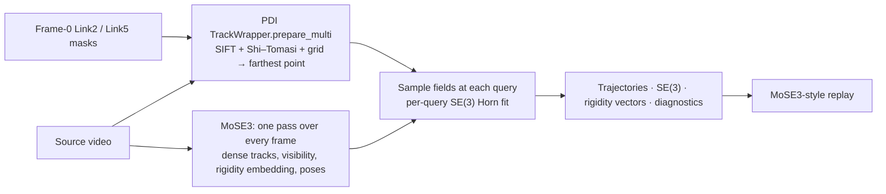

# MoSE3 tracking path for Link2 and Link5

One of the robot pipeline's two rigidity paths, parallel to PDI's fixed point pairs
(`robot/workflows/pipeline.py`, `robot/scoring/metrics.py`). Both start from the same
frame-zero link masks and the same PDI query sampler. The pair path follows the points with
CoTracker3, samples MegaSAM geometry and scores distance ratios over a fixed pair graph. This
path follows them with [MoSE3](https://mose3-tracker.github.io/) (NeurIPS 2026). From
monocular RGB alone, MoSE3 predicts a world-space 3D track, a visibility logit and a 16-D
rigidity embedding for every pixel of a query frame, then fits a per-pixel SE(3) with a
weighted Horn solve. Its signals are rigid residuals, the rigidity discrepancy and slice seams.
The current runs cover the selected 45 videos; the signals are diagnostics, not
validated detectors.

| Stage | Code | Interface |
| --- | --- | --- |
| Frozen inputs (videos, frame-zero masks) | `robot/workflows/mose3/inputs.py` | |
| PDI query initialization (CPU, geometry env) | `robot/workflows/mose3/initialize_queries.py` | `links.mose3-queries` |
| MoSE3 pass on one shared H200 (mose3 env) | `robot/workflows/mose3/run_gpu_batch.py`, `worker.py`, `point_fields.py` | `links.mose3-track` |
| Transfer check | `robot/workflows/mose3/collect.py` | `links.mose3-collect` |
| Signals | `robot/scoring/mose3/signals.py`, `rigidity.py` | `links.mose3-signals` |
| Label AUROC | `robot/analysis/mose3_label_auroc.py` | `links.mose3-auroc` |
| Replay | `robot/replay/mose3/` (`build_replay.py`, `render_views.py`, `templates/`) | `links.mose3-views`, `links.mose3-replay` |
| ERIS launchers | `robot/workflows/mose3/eris_job.sh`, `eris_pipeline.sh` | |
| Tests | `robot/tests/test_mose3_*.py` | |

Runs live in `robot/results/mose3/<run>` (`20261012`, and `20261014-dense`, a bit-identical
rerun that also caches the link-mask fields). This code moved here from
`robot/experiments/mose3_tracking/` on 2026-10-15 without numerical changes; the moved
replay rebuilds byte-identically.



## What is reused, unchanged

- **Query initialization:** `infrastructure/shared/inference/tracking.py`
  `TrackWrapper.prepare_multi`, called on a model-free instance in the PDI geometry
  environment. It decodes at most 880 px, resizes the frame-zero mask by nearest
  neighbor and runs `CoTrackerCore._sample_region_queries`. Counts come from
  `robot/configs/default.yaml`: 256 Link2 and 100 Link5 queries. No PDI pair graph
  is used.
- **MoSE3:** pinned submodule `infrastructure/vendor/MoSE3` at `c39ef00`, weights
  `mose3-tracker/MoSE3@5280ca2` (CC BY-NC 4.0, includes π³). Frames are loaded
  with upstream `load_video_clip` (every original frame, at most 518 px, multiples of 14).
  Tracks are re-expressed in the first camera's frame with upstream
  `_to_first_camera_frame`, as in `inference.py`.
- **Per-query SE(3):** the same random 12,000-pixel pool, temperature 0.01 softmax and
  `weighted_centroids` / `solve_rotation_horn` as `fit_per_pixel_se3`. Only the query
  row is sampled at the sub-pixel query position. With integer pixels the result
  equals upstream (`tests/test_point_fields.py`).

Queries map to the MoSE3 grid with the pixel-centre convention. Fields are sampled
bilinearly. A query whose four taps touch a MoSE3 depth edge (upstream
`depth_edges`, relative spread 0.05) uses its nearest pixel instead, so it does not
blend foreground and background. That point is flagged `on_depth_edge`.

## Inputs

`inputs.py` freezes 45 cases from local, hash-checked archives:

| Link | Frame-zero mask source |
| --- | --- |
| Link2 | `link5-link7-four-way-selected45-20260927/cases/*/base_segmentation.npz` (six-link SAM3 base) |
| Link5 | `link5_shape_codebook/results/round_four_frame0` (latest guarded mask cache) |

Both archives record the same source-video SHA-256 for every case. Link5 review labels
are carried, not used to drop videos: `LVP_ROBOWM_0010`, `LVP_ROBOWM_0030`,
`COSMOS3_0021` and `COSMOS3_0035` have user-rejected masks; `COSMOS2.5_0010` is
excluded by the Link5 handoff. The replay flags them.

## Outputs per video (`results/<run>/cases/<video>/`)

| File | Contents |
| --- | --- |
| `link2.npz`, `link5.npz` | `point_ids`, query pixels, `trajectories_world[T,N,3]`, `trajectories_uv_source[T,N,2]`, `visibility_logit`, `visible`, `in_frame`, `rigidity_embedding_query[N,16]` (the rigidity vector), `rigidity_embedding_tracked[T,N,16]`, `se3_quat_wxyz`, `se3_trans`, `se3_valid`, `se3_origin`, display frames and colours |
| `dense_link2.npz`, `dense_link5.npz` | MoSE3's fields at every grid pixel of the link's frame-zero mask and a 4 px band around it: `pixels_hw`, `mask_fraction`, `mask_signed_distance_px` (positive inside, 1 on the border ring), `on_depth_edge`, `tracks[T,M,3]`, `visibility_logit[T,M]`, `rigidity_embedding_query[M,16]`. Runs from 2026-10-14 on. |
| `rigidity.json` | Per-frame series and frame 1…T−1 means for all points and for points away from depth edges; frame-0 reprojection QA |
| `scene.npz` | Replay-only dense cloud (stride 4, depth edges removed, float16), RGB/PCA colours, poses, intrinsics |
| `receipt.json` | Hashes, settings, timings, GPU peaks, environment |

All 3D values are in MoSE3's first-camera frame and π³ scale (x right, y down,
z forward); they are not MegaSAM coordinates. The `rigidity.py` diagnostics (rigid-fit
residual, all-pairs PDI distance-ratio MAD/median, SE(3) rotation spread and
rigidity-embedding dispersion) are not validated deformation detectors.

## Run on ERIS

```bash
python -m robot.workflows.mose3.inputs --output robot/results/mose3/<run>/inputs
bash infrastructure/deployment/eris/prepare_environment.sh "$DEPENDENCY" mose3       # env, pinned source, weights
sbatch --partition=interactive --account=wang --cpus-per-task=16 --mem=64G --time=01:00:00 \
  robot/workflows/mose3/eris_job.sh queries "$WORKSPACE" "$DEPENDENCY" "$RUN" "$VIDEOS"
sbatch --partition=gpu-h200 --account=wang --gres=gpu:nvidia_h200:1 --cpus-per-task=32 --mem=256G --time=01:30:00 \
  robot/workflows/mose3/eris_job.sh track "$WORKSPACE" "$DEPENDENCY" "$RUN" "$VIDEOS" --initial-workers 5
sbatch --partition=gpu-h200 ... eris_job.sh render "$WORKSPACE" "$DEPENDENCY" "$RUN" "$VIDEOS"   # display-only; --gpu-model L40S on gpu-l40s
python -m robot.replay.mose3.build_replay --run robot/results/mose3/<run> --sources "$LOCAL_VIDEOS"
```

`run_gpu_batch.py` uses one H200 and separate worker concurrency. Each worker loads
MoSE3 once and claims videos, longest first, through exclusive lock files. The first five
videos measure baseline throughput and per-worker peak memory. More workers start
only if that peak, plus headroom, fits within 85% of the card. They are retained only if
source frames per second improve. `scancel` cancels every worker and launches no
queued videos. Out-of-memory failures are retried once at half concurrency.

## Link deformation signals

`signals.py` computes three signals per link from the saved PDI-point outputs (no new GPU
pass). Points touching a MoSE3 depth edge and query-frame depth outliers are left out.
`L` is the link length along its long axis (2nd–98th percentile):

1. **Rigidity discrepancy:** 90th percentile of `1 - cos(e_i(t), mean)` over the frame-t
   rigidity embeddings at the tracked pixels.
2. **Rigid residual:** 90th percentile of `||R_i(t) x_i(q) + t_i(t) - x_i(t)|| / L` with
   MoSE3's per-point SE(3), plus a visible-points Kabsch refit. The **dense fit** instead fits
   one transform per frame to the link's whole frame-zero mask from `dense_<link>.npz`: grid
   pixels more than 2 px inside the border, off depth edges, depth inliers and visible at t,
   with Cauchy IRLS weights so pixels where the mask leaks onto another surface lose their pull.
   It is scored at the same PDI points (`rigid_residual_dense`) and over the fitted pixels
   (`rigid_residual_dense_all`), both divided by the length of the fitted pixels. A frame is
   undefined unless 200 pixels and 30% of the fitted pixels are visible and span half that length.
3. **Slice seams:** four equal-length slices, one Kabsch fit per slice (at least 8 visible
   points), with stretch, shear, bend and twist at each seam.

The dense-pixel plan's joint check is not computed. Only the mask fields above are cached,
not the whole frame.
`label_auroc.py` compares the signals with the selected-45 labels, both pooled and **within
generator**. The labels are confounded with generator (Link2: COSMOS2.5 11 severe / 2 none,
COSMOS3 0 / 13). Outputs: `results/<run>/signals/` (`signals.csv`, per-frame `frames/`,
`label_auroc.json`, `REPORT.md`).

## Replay

The replay follows the MoSE3 project page and opens from `file://`
(three.js r147 is vendored in `infrastructure/shared/replay/assets/three-r147/`).

- **`replay/index.html`:** all videos in a gallery of looping clips. It has the project
  page's view switcher and per-view notes, generator filters, sorting by score and a
  points selector (all, or away from depth edges). Twelve videos per page, plus a sortable
  score table. Each clip opens its replay.
- **`replay/video.html?case=<video>`:** *Explore in 3D*. The dense query-frame cloud moves
  through time with RGB or rigidity-embedding colours, or is hidden (*Points only*).
  SE(3) tripods sit on 24 spread-out points per link, and every point leaves a 12-frame trail.
  A picture-in-picture input video follows the same clock. Click a point to follow it: its
  whole path is drawn, and a card shows its query pixel, visibility, rotation since frame 0,
  rigid-fit residual and 16-D rigidity vector. Below are the 2D views and the rigidity strip.

- **`replay/signals.html?case=<video>&signal=<key>`:** the error-signal replay (white is rigid, redder is more error),
  with expandable explanations of how each signal is derived and measured. Each tracked point is
  coloured by its own per-frame value on one sequential scale shared by all videos (95th
  percentile of all per-point values; brighter is larger). The signal is the rigid residual
  against MoSE3's SE(3), the visible-points refit, the dense mask fit, or the rigidity discrepancy. For the
  residuals, rings mark the rigid prediction and a line joins it to the tracked point. Below
  is the per-frame 90th percentile for each link, with max markers. Click or drag it to seek;
  click a point to add its own curve. The sortable index of every video lists its labels and
  each link's maximum, and loads any video in place.

**Published** 2026-10-13 at https://wilsonnijc-bot.github.io/mose3-robot-link-replay/ (public repo
`Wilsonnijc-bot/mose3-robot-link-replay`, about 540 MB). Updated 2026-10-15 (commit `8ec4e63`) from run
`20261014-dense`: adds the dense mask fit and, per signal, the C-index with moderate labels kept. `index.html` is a first page
offering the error-signal replay (`signals.html`) or the tracking + SE(3) replay (`videos.html`).
`capture_preview.py` records the error-signal preview from the built replay. It is the run `20261012` replay with
the 2D views re-encoded (H.264 CRF 28, frame counts checked); everything else is byte-identical.

2D views (`render_views.py`, CPU) call upstream `visualize.render_tracks` and
`render_se3_axes` unchanged, on a 1 x N "image" of the tracked points. *Tracks, camera
fixed* re-renders the world-space tracks from the frame-zero camera. *Rigidity embedding*
needs the dense per-frame embedding, which the tracking run does not keep.
`render_worker.py` (`eris_job.sh render`) repeats the forward pass for display only and
writes upstream `pca_rgb` over the clip. It records how closely the repeated pass
reproduces the saved trajectories; tracking outputs are never rewritten.

Unattended on ERIS: `eris_pipeline.sh` submits `track`, then the CPU `signals` stage once
tracking exits 0, from a login-node tmux session. Killing the session cancels the active job,
and no later stage is submitted.

```bash
module load tmux
tmux new-session -d -s mose3-dense \
  "bash $WORKSPACE/robot/workflows/mose3/eris_pipeline.sh $WORKSPACE $DEPENDENCY $RUN $VIDEOS --initial-workers 5 --max-workers 8"
```

```bash
python -m robot.workflows.mose3.collect --run robot/results/mose3/<run>
python -m robot.replay.mose3.render_views --run robot/results/mose3/<run> --sources "$LOCAL_VIDEOS"
python -m robot.replay.mose3.build_replay --run robot/results/mose3/<run> --sources "$LOCAL_VIDEOS"
```
